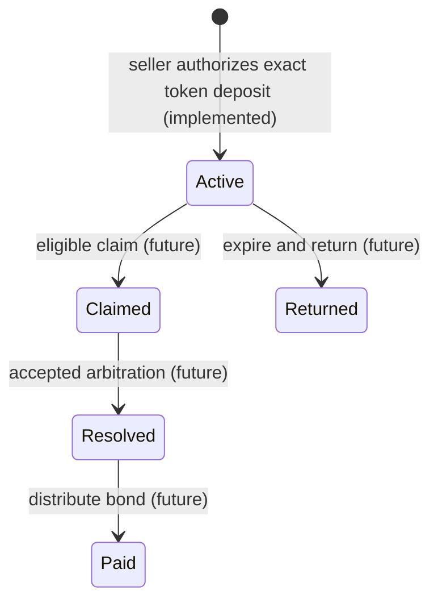

# SoroBond V1 — limited warranty bond protocol

**Scope of Issues #1–#4:** Soroban Rust package, immutable versioned agreement model, authorized **deposit only**, asset allow-list pinned in constructor, accounting and event emission. Claims, dispute evidence, resolution and withdrawal **are not yet implemented**. Contract must not be deployed with valuable assets while there is no withdrawal path and no review of the full lifecycle.

## Participants and legal boundaries

- Seller: agrees to lock an exact quantity of a configured Stellar asset to support a limited warranty. Only the seller can authorize its deposit.
- Buyer: identified counterparty to the specific agreement, not automatically entitled to all of the sale price.
- Independent arbitrator: chosen before depositing, cannot equal either party. A human or external system must decide whether goods are defective; the blockchain cannot inspect physical goods.
- Asset issuer/token contract: an external trust assumption. The token contract's identity is immutable for the SoroBond deployment and must be validated and reviewed before production use. Admin controls, clawback and contract upgrades are external risks.
- Ledger time: `Env::ledger().timestamp()` determines bounded expiry. Off-chain clocks do not control settlement.

## Planned lifecycle

1. Buyer and seller agree off-chain on a private sales description and objective warranty terms; store only a 32-byte hash on-chain.
2. Seller signs deposit transaction: program checks distinct parties, positive bond, 1-hour to 90-day duration, and overflow-safe deadline; locks exact asset from seller into contract.
3. Versioned record is stored; `WarrantyCreated` event is emitted after transfer succeeds. `locked_total` is increased by exact deposit.
4. **Future PR:** buyer files an eligible claim before expiry. **Future PR:** signed mutual settlement or predetermined arbitrator decision. **Future PR:** funds released once to the buyer or seller. These paths are not available yet.

All state transitions except the initial `Active` deposit are future work. This preliminary state model is not a guarantee of insurance, compensation or buyer protection.

## Storage and constraints

- Warranty fields: `version = 1`, monotonic `id`, `seller`, `buyer`, `arbitrator`, `token`, `bond_amount`, `created_at`, `expires_at`, `terms_hash`, `status = Active`.
- `token` is a single immutable constructor-injected asset contract; the address is the full asset identity, avoiding code-only ambiguity.
- `bond_amount` must be positive i128; `locked_total` uses checked addition; each deposit transfers exact balance difference and cannot reuse an id.
- `Depositing` guard blocks reentrant deposits; any failing token call rolls back the entire Soroban transaction.
- Contract data TTL is not yet extended for long-term storage: ledger archival/restoration must be completed and tested before public use. Do not assume a 90-day bond remains accessible without an explicit TTL strategy.

## Verification

Native tests use the Soroban SDK test environment and a real local Stellar Asset Contract. They check exact balances, monotonic IDs, versioned data, invalid terms, zero/failing deposits and seller authentication. Tests do not represent testnet or mainnet funds. Use `cargo test` in `contracts/`; Wasm builds require `stellar contract build` and a suitable CLI/toolchain.
