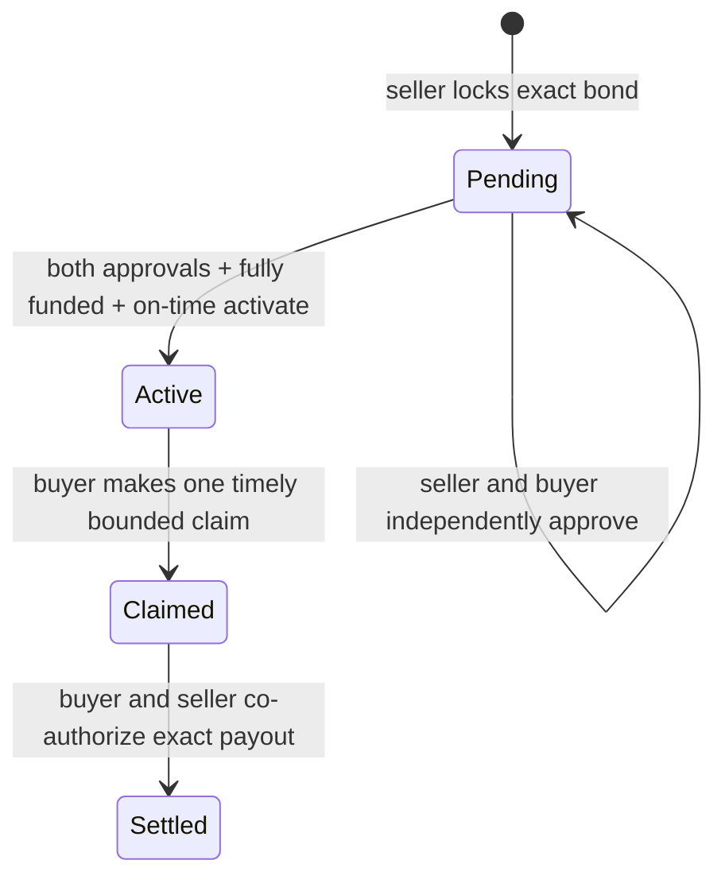

# SoroBond V1 — experimental warranty bond lifecycle

**Implementation through issues #1–#8:** Soroban Rust contract, exact allow-listed token deposits, versioned agreement, mutual consent, funded activation, buyer claim freeze and exact mutually authorized settlement. This is not an insured sale, arbitration service, physical-defect oracle or independently reviewed product.

## Roles and assumptions

- **Seller:** funds the exact bond from the configured token contract and separately approves its immutable offer.
- **Buyer:** independently approves the same offer, may submit one claim on time, and co-authorizes any settlement.
- **Arbitrator:** immutable negotiated identity but **cannot currently resolve disputes**. The independent arbitration/timeout pathway is not implemented in issues #5–#8.
- **Token:** one constructor-pinned contract; admin controls and clawback remain risks. No fee-on-transfer or rebasing token support.
- **Ledger:** timestamp is authoritative; offer validity is 24 hours, and warranty duration is 1 hour to 90 days, counted from activation.

## Contract lifecycle

The claim deadline is **inclusive**. No automatic release exists at expiry, and no seller withdrawal exists during a disputed claim. The `Settled` state and total locked-balance debit are terminal and atomic with the token payouts. Zero or partial buyer payout is permitted with both parties' signatures, and the remaining bond is returned to seller. No fees are charged.

## Data model

`Warranty` persists its original seller, buyer, arbitrator, token, bond amount, terms hash and creation timestamp along with `offer_expires_at`, `duration_seconds`, `activated_at`, `expires_at`, both approval flags and lifecycle status. `Claim` persists the amount, evidence hash and submission timestamp under the warranty id. Only hashes, not sensitive item descriptions, are stored on-chain.

Each `approve` signature is based on Soroban's contract/network-scoped invocation authorization. Stored terms are never mutable. `locked_total` includes all funded Pending, Active and Claimed bonds and decreases only after a successful mutually authorized full settlement. Token transfer deltas verify exact receipt and debit.

## Important deployment blockers

No refund path for an unclaimed expired warranty or abandoned offer; no adjudicator-authorized claim resolution; no TTL extension/restoration; no external security audit; no real network validation. A frozen bond without a willing counterparty can remain inaccessible. **Never use real funds with this draft contract.** See [Lifecycle security](lifecycle-security.md) and [Threat model](threat-model.md).
